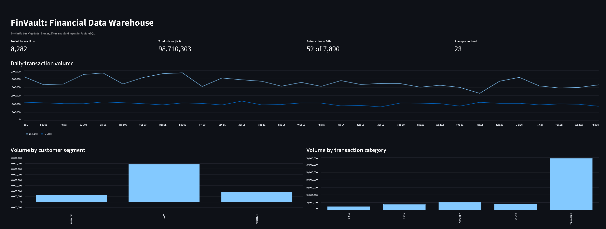
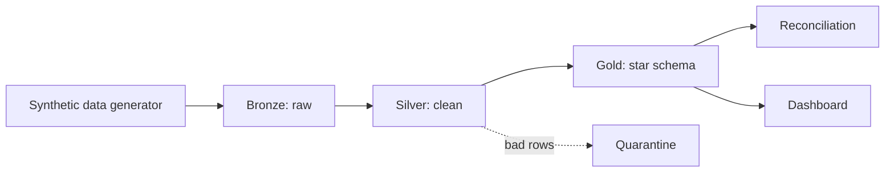

# FinVault: Financial Data Warehouse

A data warehouse built on **synthetic banking data** (no real financial data).
It loads raw data, cleans it, builds a star schema, and checks that the money adds up.

**Tech:** PostgreSQL · SQL · Python · dbt · Docker · pytest · Streamlit (Airflow DAG included)



## How it works



| Layer | What happens |
|---|---|
| Bronze | Raw CSV rows loaded as-is, tagged with a batch ID. Every batch is logged in an audit table |
| Silver | Duplicates removed, bad rows (zero amount, missing or unknown account) moved to a quarantine table, real data types |
| Gold | Fact and dimension tables. Customers and accounts keep their history (SCD Type 2) |
| Checks | Opening balance + transactions must equal closing balance, every account, every day |

## Main ideas shown in this project
- **Star schema:** `fact_transactions`, `fact_daily_account_balance`, `dim_customer`, `dim_account`, `dim_date`, `dim_transaction_type`
- **SCD Type 2:** if a customer moves city, the old transactions still point to the old city
- **Incremental loading:** only new batches are processed, and re-running is safe
- **Data quality:** 24 dbt tests plus 7 pytest tests
- **Reconciliation:** finds days where the balance does not match the transactions

## Results
The generator plants known problems on purpose, so the warehouse can be tested against a known answer.

- Reconciliation found **52 of 52** planted balance errors, with no false alarms
- Quarantine caught every planted bad row; duplicates were removed
- Gold transaction count equals Silver exactly, so the joins lost and duplicated nothing

## Run it

```bash
docker compose up -d                       # start PostgreSQL
pip install -r requirements.txt
python data_generator/generate_data.py     # create synthetic data
python ingestion/run_pipeline.py           # bronze -> silver -> gold -> checks
pytest tests/test_warehouse.py -v          # run the tests
streamlit run dashboards/app.py            # open the dashboard
```
Copy `.env.example` to `.env` first and set a password. For dbt, set the `POSTGRES_PASSWORD` environment variable.

## Folders

```
data_generator/   creates the synthetic data and plants the problems
ingestion/        bronze loader and pipeline runner
sql/              bronze, silver and gold SQL
dbt_project/      dbt models and data tests
dags/             Airflow DAG (same commands as the pipeline runner)
tests/            pytest tests
dashboards/       Streamlit dashboard
docs/             business rules
```

More detail: [`docs/business_rules.md`](docs/business_rules.md)

## Limits
Synthetic data, one month, runs locally. The Airflow DAG is written but I ran the pipeline with `run_pipeline.py`, not inside an Airflow server.